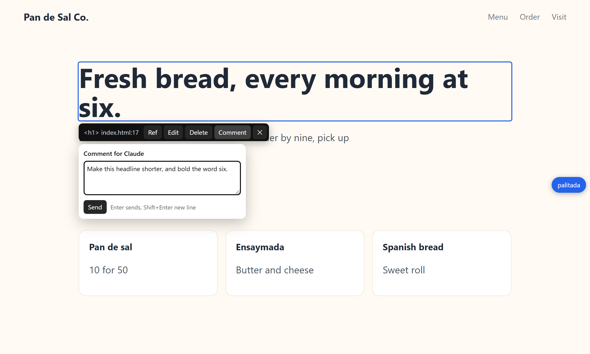

<div align="center">


# palitada

**Click any element on your local dev page to edit its text, delete it, or hand it to Claude Code.**

Palitada is Filipino for plastering: point at a rough spot in your UI and smooth it over (and palit + ui, swap the UI, hides in the name).

[](#install)
[](https://nodejs.org)
[](LICENSE)

[](https://code.claude.com/docs/en/channels-reference)
[](skill/SKILL.md)
[](#how-it-works)

[](#how-it-works)
[](#how-it-works)
[](#how-it-works)
[](#how-it-works)

</div>



## Install

```sh
npm install -g github:riecodes/palitada
```

## Run

Start your dev server as usual, then from your project folder:

```sh
palitada 3000        # your dev server's port or URL
```

Open http://localhost:4747, press **Alt+P** (or click the pill on the right edge), and click an element. Esc closes the panel, then the selection, then the picker. Nothing is added to your project.

## What a click gives you

- **Edit** its text in place. palitada finds the string in your source and saves it, with Undo in the toast.
- **Delete** it, or **Comment** on it. These queue up for Claude Code with the file:line, the component chain, a selector and a screenshot (the element boxed in red inside its section).
- **Ref** it: copies a block you paste into any Claude prompt.

## With Claude Code

Copy the skill once, then type `/palitada` in a session to work through the queue:

```sh
cp -r "$(npm root -g)/palitada/skill" ~/.claude/skills/palitada
```

Or by hand:

```sh
palitada queue           # open comments and deletes
palitada done <id...>    # mark items done
```

Flags: `--port 4747`, `--root <project dir>`, `--project <name>`.

### Push straight into a session

palitada is also a Claude Code [channel](https://code.claude.com/docs/en/channels-reference). With it, comments, deletes and refs land in your open session as soon as you send them, without typing `/palitada`.

1. Add palitada to the project's `.mcp.json` (copy [`mcp.json`](mcp.json) or merge in this entry):
   ```json
   { "mcpServers": { "palitada": { "command": "palitada", "args": ["channel"] } } }
   ```
   On Windows, use `"command": "cmd", "args": ["/c", "palitada", "channel"]`. It has to be the project's `.mcp.json`: `--mcp-config` doesn't work for channels.
2. Start the session in that folder with the channel flag, and confirm the prompts the first time:
   ```sh
   claude --dangerously-load-development-channels server:palitada
   ```
3. The browser toast then says "sent to Claude". The session gets each item as `<channel source="palitada" ...>`, does it, and marks it done with the `palitada_done` tool.

Good to know:
- Sessions started without the flag spawn the server, which then stays idle.
- With no listening session, items wait in the queue for `/palitada`. A new listening session announces them first and asks before working on them.
- If two sessions listen on the same project, only one gets each item.
- Claude Code doesn't register channels that negotiate the 2026-07-28 MCP revision, so the server is a small hand-written JSON-RPC loop that stays on 2025-06-18.

## How it works

- `palitada.mjs` is a small proxy in front of your dev server. It adds a loader script to HTML pages, strips CSP and passes HMR websockets through. Writes are accepted only from the page itself (local Host and Origin, JSON only). Nothing leaves your machine.
- Where an element lives in the source:
  1. Astro's `data-astro-source-file` attribute.
  2. The React component chain, server components included, with each component's file found by grep.
  3. The visible text, searched in the source with flexible whitespace and entities.
  - A text match counts only when it is in a file of the element's own component chain. If it isn't, the text probably comes from data (a DB or CMS), and palitada says so instead of guessing.
- The queue, edit log and screenshots live in `~/.palitada/<project>/`, outside your repo.
- Deletes go to Claude, not a regex, so JSX stays valid and Claude Code's rewind covers the change.

Works with Next.js and React, Astro, Laravel Blade, and any server that returns HTML.

## Limits

- Edit is plain text only: no `< > { }`, and only text that is literally in the source (not text built from `{variables}`).
- Text rendered from data can't be edited here; comment on it instead.
- On pages that render both languages as `span.lang-fil` + `span.lang-en`, an edit lands in the half you clicked, and the other language is left as is.
- Laravel pages whose links use `APP_URL` leave the proxy when clicked: open them through the proxy port.

## Test

With a dev server and the proxy running:

```sh
npm install                # playwright-core, for the test only
node test.mjs http://localhost:4747/ <project root> <backup dir>
```

It edits one text in a clean git file, undoes it (byte-equal check), queues a comment, a delete and a ref, checks their screenshots and the CSRF guard, then marks its items done. It uses your installed Chrome; set `CHROME_PATH` to use another Chromium build.

## License

[MIT](LICENSE)
